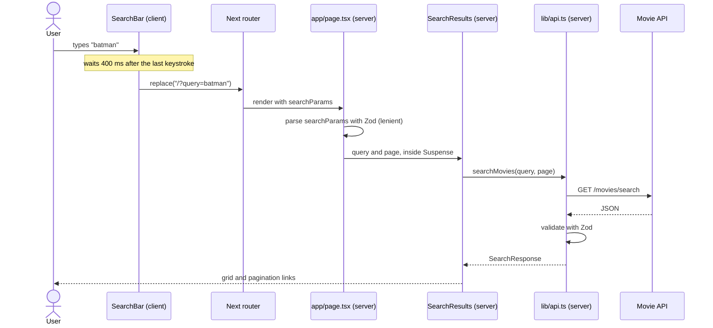

# Architecture

This doc walks through how search works, from the search box to the results, and what happens when something breaks. To know why certain choices were made, see [Technical decisions](technical-decisions.md). For what runs on the server versus the client, see [Server vs client components](server-vs-client.md). For the mock API, see [Mock API](mock-api.md).

## Overview

It's a Next.js App Router project with three routes:

| Route              | What it does                                                                             |
| ------------------ | ---------------------------------------------------------------------------------------- |
| `/`                | Shows trending movies. If there's a `query` in the URL, it shows search results instead. |
| `/movies/[id]`     | Shows details for one movie, plus the trailer.                                           |
| `/api/mock/v1/...` | Mock API endpoints we use for development and testing.                                   |

Most of the design is driven by:

1. **The URL holds the search state.** The query and page number live in the URL (`/?query=batman&page=2`). The search bar writes to it, and the server reads from it.
2. **Nothing from the network is trusted.** Every API response goes through Zod before a component sees it, so a change in the real backend shows up as a clear contract error and not as `undefined` in the UI.

## Folder layout

- **One folder per component** The component, its test and an `index.ts` all live together. Anything tied to that component, like its skeleton, error boundary or fallback, goes in there too (for example `Trailer/TrailerBoundary.tsx`). That way, deleting a feature means deleting one folder.
- **`components/Shared`** is for pieces that more than one feature uses.
- **`lib/utils/` is split by use case, not kept in one `utils.ts`.** Each file has a single purpose (`pagination.ts`, `videos.ts`, `format.ts`) and its own test next to it. Tests stay short, imports are easy to read, and you can change one file without worrying about the others.
- **Tests sit next to the code they test.**

## User search flow

### Search params

| Param   | Rules                    | If it's invalid       |
| ------- | ------------------------ | --------------------- |
| `query` | A trimmed string         | `""` (shows trending) |
| `page`  | A whole number, 1 to 500 | `1`                   |

### Pagination

`Pagination` is a server component built from plain `<Link>`s. The page numbers and the Previous/Next links come from the response's `page`, `totalPages` and `totalResults`. A small pure function, `getPageItems` in `lib/utils/pagination.ts`, decides which numbers to show: the first and last pages, the current page and the ones next to it, and ellipses to cover the gaps.

We use `MAX_PAGE` (500) as a cap on `searchParamsSchema`. It matches the assignment's contract, which rejects any `page` over 500. Ideally the limit would come only from the data returned by the API, so think of the constant as a safety check, not the real source of truth.

## Error handling

### API routes

The API uses three helpers, `badRequest()`, `notFound()` and `serviceUnavailable()`, to turn errors into the right HTTP responses.

### UI

Failures are contained at the smallest useful scope, so one failed request doesn't break the whole page.

| Boundary                                         | What it catches                                               | What the user sees                                          | What happens to the rest of the page   |
| ------------------------------------------------ | ------------------------------------------------------------- | ----------------------------------------------------------- | -------------------------------------- |
| `SearchResultsBoundary` (`react-error-boundary`) | The search request failed, or the response broke the contract | A short message with "Try again"                            | The search bar still works             |
| `TrailerBoundary` (`react-error-boundary`)       | The videos request failed                                     | A short message with "Try again" where the trailer would be | Movie details stay on screen           |
| `app/movies/[id]/error.tsx` (route segment)      | The movie details request failed                              | An error page with "Try again" and a link home              | Nothing, it replaces the whole segment |
| `app/error.tsx` (route segment)                  | Everything else, including a failed trending request          | An error page with "Try again"                              | Nothing, it replaces the whole segment |

A few related things:

- **`not-found.tsx`** covers a movie that doesn't exist (`404`) and an id that's malformed.
- **`loading.tsx`** (at the root and in `movies/[id]`) shows skeletons while a page loads. `Suspense` fallbacks do the same job for search results and the trailer.
- **No trailer is not an error** If no YouTube video exists, nothing is rendered.
